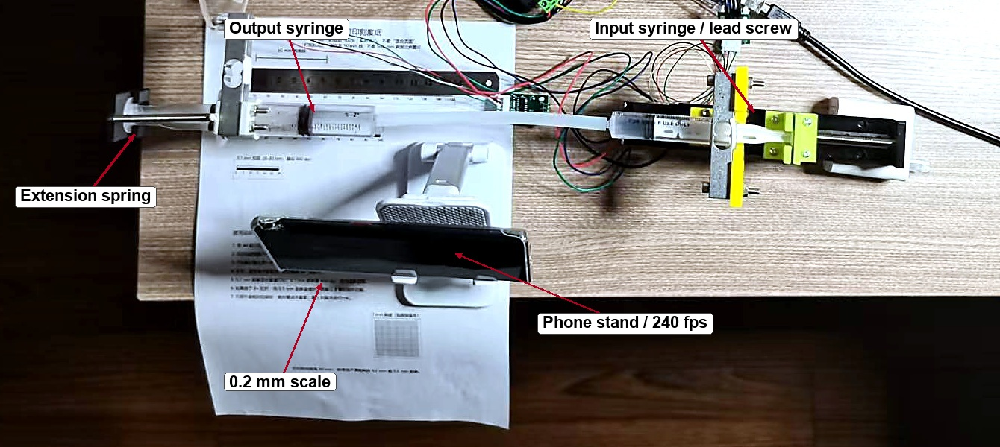

# Bubble Compliance in a Syringe Hydraulic Transmission

**Static stiffness, dynamic response, and variable stiffness — an experimental study with 1, 2, and 5 mL air volumes**

Author: **Zihao Huang** · October 2026

This repository contains the English technical report, the measured data, and the Python code used to produce every figure and table. It is a technical report, not a peer-reviewed journal article. The Chinese internal report is intentionally not included.

---

## Summary

A trapped air bubble is usually treated as a defect in a hydraulic circuit. This work shows that the same bubble can be used as a passive, valve-free variable-stiffness element. A 10 mL input syringe, a 20 mL output syringe, a silicone tube, and an output extension spring form the circuit. Known air volumes of 1, 2, and 5 mL are injected. Static tests use known water weights (0.3, 0.55, and 0.85 kg); dynamic tests use a fast input step and a 240 fps phone camera.

The static stiffness follows the air-spring law `K_air = n p0 A_out^2 / V`, the time constant grows linearly with air volume, and the spring and bubble act in parallel. The three data sets are mutually consistent, and the results quantify the soft–slow trade-off of bubble-based stiffness tuning.

## Key results

| Air volume | `K_air` (N/mm) | `tau` (s) | `K_eff` (N/mm) |
|---:|---:|---:|---:|
| 1 mL | 6.82 ± 1.60 | 0.113 ± 0.001 | 7.44 ± 0.25 |
| 2 mL | 3.41 ± 0.13 | 0.181 ± 0.013 | 4.57 ± 0.09 |
| 5 mL | 1.38 ± 0.02 | 0.409 ± 0.029 | 2.40 ± 0.05 |

Linear fits:

- `1/K_air = 0.0038 + 0.1439 V` (three-point fit, R² = 1.0000), giving `C = 6.95 N·mm/mL`, `V0 = 0.03 mL`, and `n = 1.00`.
- `tau = 0.035 + 0.074 V` (three-point fit, R² = 0.9995).
- `K_eff = k_s + K_air` within 5%; calibrated spring `k_s = 1.02 ± 0.01 N/mm`.
- Stiffness tuning range over 1–5 mL: about **3.1×**.

The R² values are for three mean points only; they describe collinearity and are not a test of statistical significance.

## Figures



**Figure 2.** Hydraulic circuit and displacement measurement: output syringe and extension spring (left), input syringe and lead screw (right), 0.2 mm scale, and the 240 fps phone on its stand.

The full report contains the schematic, spring calibration, static stiffness, time constant, normalized step responses, and soft-joint stiffness figures.

## Hardware

The `hardware/stl/` folder contains the 3D-print files and `hardware/scad/` contains the OpenSCAD sources for the syringe flange clamps, the slider-to-push-rod coupler, the push-rod clips for 5, 10, and 20 mL syringes, and the load-bar hook. Print settings and assembly notes are in [`hardware/README.md`](hardware/README.md). Dimensions are in millimetres. These parts are fixture components, not pressure-rated hardware. All parts are from the bubble-compliance fixture; the older load-cell efficiency setup is not included.

## Repository layout

```text
.
├─ report/
│  ├─ Bubble_Compliance_Report_EN.pdf
│  └─ Bubble_Compliance_Report_EN.docx
├─ figures/
│  ├─ fig1_schematic.png
│  ├─ fig2_setup.jpg
│  ├─ fig3_spring_calibration.png
│  ├─ fig4_static_stiffness.png
│  ├─ fig5_time_constant.png
│  ├─ fig6_step_responses.png
│  └─ fig7_soft_joint.png
├─ hardware/
│  ├─ stl/
│  │  ├─ flange_clamp.stl
│  │  ├─ slider_coupler.stl
│  │  ├─ plunger_clip_5ml.stl
│  │  ├─ plunger_clip_10ml.stl
│  │  ├─ plunger_clip_20ml.stl
│  │  └─ bar_hook.stl
│  ├─ scad/
│  │  ├─ flange_clamp.scad
│  │  ├─ flange_clamp_force.scad
│  │  ├─ slider_coupler.scad
│  │  ├─ plunger_clip.scad
│  │  └─ bar_hook.scad
│  └─ README.md                    # print settings, assembly, license
├─ analysis/
│  ├─ bubble_stiffness.py          # fittings and the original analysis commands
│  ├─ plot_en.py                   # English-labelled figures
│  ├─ make_setup_en.py             # English schematic and annotated photo
│  └─ data/bubble/                 # measured CSV/JSON files and figure inputs
├─ requirements.txt
├─ CITATION.cff
├─ LICENSE                         # MIT for the code
└─ LICENSE-CC-BY-4.0.txt           # CC BY 4.0 for the report, figures, and data
```

## Data

All numbers in the report come from measured CSV files. There is no synthetic or simulated data.

| File | Content |
|---|---|
| `static.csv` | static experiment: air volume, load, output displacement, repeat |
| `static_repeats.csv`, `static_summary.csv` | per-repeat and mean stiffness |
| `static_fit.json` | `C`, `V0`, and `n` from the `1/K–V` fit |
| `demo.csv` | soft-joint experiment (spring installed) |
| `demo_repeats.csv`, `demo_summary.csv` | per-repeat and mean `K_eff` |
| `spring_calib.csv`, `spring_fit.json` | spring calibration and `k_s` |
| `step_meta.csv` | index of the valid step files |
| `step/*.csv` | step responses: `t_ms`, `x_out_mm` |
| `step_summary_raw.csv`, `step_summary.csv`, `step_fit.json` | per-run and per-volume `tau`, and the `tau–V` fit |

The measured data can be reused under CC BY 4.0 with attribution.

## Reproduce the fits and figures

```bash
python -m venv .venv
# Windows: .venv\Scripts\activate
# Linux/macOS: source .venv/bin/activate
pip install -r requirements.txt

python analysis/bubble_stiffness.py static --dir analysis/data/bubble --area-out 262
python analysis/bubble_stiffness.py step   --dir analysis/data/bubble
python analysis/bubble_stiffness.py demo   --dir analysis/data/bubble --k-spring 1.02 --area-out 262

python analysis/plot_en.py
python analysis/make_setup_en.py
```

The final report is included in `report/` as DOCX and PDF. The script that assembles the DOCX is intentionally not included in this repository; the repository focuses on the measured data, the fits, and the figures. The analysis script prints some messages in Chinese because it is the original measurement script; all data columns and numerical outputs are language-neutral.

## Experimental notes

- Input: 10 mL syringe, `A_in ≈ 160 mm²`; output: 20 mL syringe, `A_out ≈ 262 mm²` (from scale spacing and the air-spring fit).
- Output spring: `k_s = 1.02 ± 0.01 N/mm` (water calibration, 3 repeats).
- Air volumes: 1, 2, and 5 mL; residual `V0 ≈ 0.03 mL` from the `1/K` intercept.
- Static loading: 0.3 / 0.55 / 0.85 kg water; caliper readout.
- Dynamic input: 2 mm at 10 mm/s for 2 and 5 mL; 0.5 mm at 16 mm/s for 1 mL; 240 fps video.
- `tau` is defined at 63.2% of the total change, using `tau = (t63 − t10)/0.8946` to reduce the ramp effect.

## Limitations

The main limitations are the 1 mL displacement resolution, the finite input ramp, uncontrolled bubble position, a single output area, and the absence of pressure and temperature sensors. These points are discussed in Section 5.5 of the report. In particular, the `A_out²` scaling is supported indirectly and has not yet been tested with 5 and 10 mL output syringes.

## Citation

```bibtex
@misc{huang2026bubble,
  author       = {Huang, Zihao},
  title        = {Bubble Compliance in a Syringe Hydraulic Transmission:
                  Static Stiffness, Dynamic Response, and Variable Stiffness},
  year         = {2026},
  month        = {10},
  howpublished = {Technical report, GitHub},
  url          = {https://github.com/Huang-1226/syringe-bubble-compliance}
}
```

A DOI will be assigned through Zenodo when the repository is released. Update the URL and add the DOI here after the first release.

## License

- **Code:** MIT License; see `LICENSE`.
- **Report, figures, data, and 3D-print files:** Creative Commons Attribution 4.0 International (CC BY 4.0); see `LICENSE-CC-BY-4.0.txt` and `hardware/README.md`.

## Contact

Please use the GitHub issue tracker for questions about the data or the analysis.
